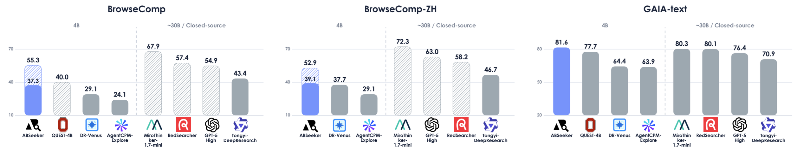

# ABSeeker: Training Long-Horizon Search Agents via Answer-Backtracked Credit Assignment

<div align="center">
  <a href="https://github.com/PolarSeeker/ABSeeker">
    
  </a>
  <a href="#citation">
    
  </a>
  <a href="https://huggingface.co/PolarSeeker/ABSeeker-4B">
    
  </a>
</div>

<div align="center">
  
</div>

**ABSeeker** is a 4B long-horizon search agent trained with **Answer-Backtracked Credit Assignment (ABC)**. Instead of assigning the same reward to every step in a trajectory, ABC recovers intermediate evidence clues from verified answers and evaluates each search step against them. These step-level rewards are used in **ABC-SFT** and **ABC-GRPO**, preserving useful actions in failed trajectories while suppressing erroneous actions in successful ones.

## Highlights

- **Strong 4B performance**: ABSeeker achieves **37.3** on BrowseComp, **39.1** on BrowseComp-ZH, **77.0** on xbench-2505, **46.0** on xbench-2510, and **81.6** on GAIA-text. With context management, BrowseComp and BrowseComp-ZH further improve to **55.3** and **52.9**.
- **Answer-backtracked credit assignment**: ABC reconstructs intermediate entities, facts, and relations from the verified answer to provide explicit process supervision.
- **Fine-grained step rewards**: **Clue-Anchored Step Scoring** evaluates whether each step discovers useful evidence, eliminates incorrect candidates, or makes erroneous decisions.
- **Unified SFT and RL training**: **ABC-SFT** reweights per-step training losses, while **ABC-GRPO** directly optimizes the policy with step-level rewards.

---

## Overview

This repository provides **inference, evaluation, and ABC data-pipeline code** for ABSeeker. The agent runs in a standard **ReAct** loop: each step, the model reasons and may call `search_web` or `visit_web`. Trajectories are saved as JSON and can be scored with the included evaluator.

For **Answer-Backtracked Credit Assignment**, the repo also includes scripts to recover intermediate clues from verified answers, extract core entities, and score individual search steps—the building blocks of **ABC-SFT** and **ABC-GRPO**.

---

## Quick Start

### 1. Installation

```bash
# Clone repository
git clone https://github.com/PolarSeeker/ABSeeker.git
cd ABSeeker

# Create conda environment
conda create --name abseeker python=3.10
conda activate abseeker
pip install -r requirements.txt
```

### 2. Configure Environment

Copy the example env file and fill in your keys:

```bash
cp configs/.env.example configs/.env
```

All scripts under `scripts/` load `configs/.env` automatically. Edit that single file for API keys, model endpoints, and `VISIT_SERVER` / `SUMMARY_MODEL_NAME`:

```bash
# See configs/.env.example for the full list. Key variables:
ABSEEKER_BASE_URL=
ABSEEKER_MODEL=models/example
SERPER_API_KEY=
JINA_API_KEY=
VISIT_HTTP_PROXY=
VISIT_SERVER=local
SUMMARY_MODEL_NAME=
DEEPSEEK_URL=
DEEPSEEK_API_KEY=
DEEPSEEK_MODEL=deepseek-chat
```

Python entry points also load `configs/.env` at startup when invoked directly.

### 3. Prepare Dataset

Place your benchmark file under `dataset/`. Each item must be a JSON object with:

```json
[
  {
    "id": "1",
    "query": "Your question here.",
    "gt": "Ground truth answer."
  }
]
```

### 4. Run Inference

The recommended entry point is `scripts/run_react.sh`:

```bash
bash scripts/run_react.sh
```

Or invoke `src/main_react.py` directly:

```bash
python -u src/main_react.py \
    --dataset dataset/example.json \
    --tool_count_max 200 \
    --num_workers 40
```

Results are written to `result/{exp_name}_{dataset_name}_react/`.

### 5. Evaluate Results

After inference, run the LLM-as-judge evaluator:

```bash
bash scripts/eval.sh
```

Or:

```bash
python -u src/eval.py \
    --result_dir result/react_browsecomp_200_react \
    --dataset_path dataset/browsecomp_200.json \
    --num_workers 10 \
    --skip_existing true
```

---

## ABC Data Pipeline

These scripts implement **Answer-Backtracked Credit Assignment** for building ABC-SFT / ABC-GRPO training data. Run them after collecting trajectories.

### Step 1: Recover Intermediate Clues

Given a dataset with ground-truth answers, recover intermediate evidence clues via backward reasoning:

```bash
bash scripts/run_recover_clue.sh
```

Output: one JSON per item under `results/{name}_recover/`.

### Step 2: Extract Core Clues

Distill recovered evidence into a compact set of key entities:

```bash
bash scripts/run_extract_clues.sh
```

Output: `results/{name}_recover/extracted/{id}.json` with `key_clues`.

### Step 3: Score Trajectory Steps

Score each step in an SFT-format trajectory against the recovered core clues (**Clue-Anchored Step Scoring**):

```bash
bash scripts/run_score_steps.sh
```

Output: `scored_result_{id}.json` per item with per-step scores and explanations.

---

## How It Works

### ReAct Search Loop

Each step in `src/main_react.py` follows this loop:

1. Build the conversation from the question, tool schemas, and prior tool results (`prompts/sft_react.py`).
2. Call the agent LLM via `ABSEEKER_BASE_URL` / `ABSEEKER_MODEL`.
3. Parse `<tool_call>` blocks from the response.
4. Execute `search_web` or `visit_web`.
5. Append the tool result and continue until the model produces `<answer>...</answer>`, hits the step limit, or gives up.

On the final allowed step, the agent is prompted to summarize evidence and output a final answer.

### Standard Tools


| Tool         | Purpose                                          | Backend                                         |
| ------------ | ------------------------------------------------ | ----------------------------------------------- |
| `search_web` | Google search via Serper                         | `SERPER_API_KEY`                                |
| `visit_web`  | Fetch page with Jina, summarize with summary LLM | `JINA_API_KEY`, `VISIT_*`, `SUMMARY_MODEL_NAME` |


### Answer-Backtracked Credit Assignment

ABC provides fine-grained process supervision without human step labels:

1. **Recover clues** — From a verified answer, reconstruct intermediate entities and facts the agent should have found.
2. **Extract core clues** — Keep the most important anchor entities for scoring.
3. **Score steps** — An LLM judge evaluates whether each step discovers useful evidence, rules out wrong candidates, or makes errors.

These step scores drive **ABC-SFT** (reweighted per-step loss) and **ABC-GRPO** (token-level RL rewards).

---

## Training

Training code lives under `training/`. **ABC-SFT** is built on [Slime](https://github.com/THUDM/slime) (Megatron-LM); **ABC-GRPO** is built on [verl](https://github.com/volcengine/verl) with ABSeeker-specific reward and advantage modules.

### ABC-SFT (Slime)

Supervised fine-tuning on multi-turn search trajectories. Set `USE_SCORE_WEIGHT=1` to enable **ABC step reweighting** from Clue-Anchored Step Scoring; `USE_SCORE_WEIGHT=0` trains a standard SFT baseline on the same data.

**Prepare**

1. Install Slime and Megatron-LM in your environment.
2. Convert scored trajectories to JSONL with an `messages` field (see ABC data pipeline above).
3. Edit path variables at the top of `training/SFT/run.sh`, or export them before running:


| Variable                   | Description                                              |
| -------------------------- | -------------------------------------------------------- |
| `SLIME_ROOT`               | Path to Slime repo                                       |
| `MEGATRON_ROOT`            | Path to Megatron-LM                                      |
| `MODEL_HF`                 | Base HuggingFace checkpoint                              |
| `MODEL_TORCH_DIST`         | Megatron torch_dist checkpoint for `--ref-load`          |
| `SFT_DATA`                 | Training JSONL (default `training/SFT/data/train.jsonl`) |
| `MASTER_ADDR`              | Head node IP (required)                                  |
| `MPI_HOSTFILE` / `SSH_KEY` | Multi-node Ray cluster                                   |
| `USE_SCORE_WEIGHT`         | `1` = ABC-SFT with per-step weights; `0` = baseline      |


**Run**

```bash
cd training/SFT
export MASTER_ADDR=<head-node-ip>
USE_SCORE_WEIGHT=1 bash run.sh
```

`run.sh` starts a multi-node Ray cluster and submits `slime/train_async.py` with context parallel, SFT loss, and optional `--use-score-weight`.

### ABC-GRPO (verl)

Reinforcement learning with `**grpo_abseeker**` (multi-turn advantage) and `**abseeker_batch**` (outcome + per-turn token rewards). During async rollout, `dr_agent_loop` calls search/visit tools and an online **anchor-clue judge** (`ABSEEKER_ANCHOR_`*) to produce `abseeker_turn_scores`.

**Prepare**

```bash
cp training/RL/.env.example training/RL/.env
```

Fill in `training/RL/.env`: `MODEL_PATH` (SFT checkpoint), `TRAIN_DATA` / `VAL_DATA` (parquet), tool APIs (`SERPER_KEY_ID`, `JINA_API_KEYS`, …), outcome judge (`JUDGE_*`), and per-turn judge (`ABSEEKER_ANCHOR_*`). See `.env.example` for the full list.

**Run**

```bash
bash training/RL/train_abseeker.sh
```

Useful overrides:

```bash
TRAIN_METHOD=grpo bash training/RL/train_abseeker.sh   # outcome-only GRPO baseline (no per-turn judge)
bash training/RL/train_abseeker.sh --train-only        # skip Ray cluster startup if cluster is already up
```

Default `TRAIN_METHOD=abseeker` uses `ADV_ESTIMATOR=grpo_abseeker`, `REWARD_MANAGER=abseeker_batch`, and async agent rollout (`configs/dr_agent_loop.yaml`). Checkpoints go to `training/RL/output/abseeker/`.

---

## Project Structure

```text
ABSeeker/
├── assets/                          # Figures and paper PDF
│   └── teasor.png                   # Overview figure
├── configs/
│   ├── .env                         # API keys and model endpoints (fill locally)
│   ├── .env.example                 # Template for configs/.env
│   └── abseeker_chat_template.jinja
├── dataset/                         # Benchmark JSON files (user-provided)
├── prompts/
│   └── sft_react.py                 # ReAct system prompt and tool schema
├── result/                          # Inference outputs (created at runtime)
│   └── {exp_name}_{dataset}_react/
│       ├── result_{id}.json         # Per-item trajectory
│       ├── logs/{id}.log            # Per-item log
│       └── eval_results.json        # Evaluation output (after eval.py)
├── results/                         # ABC pipeline outputs (recover / score)
├── scripts/
│   ├── _load_env.sh                 # Sources configs/.env (used by other scripts)
│   ├── run_react.sh                 # Shell wrapper for inference
│   ├── eval.sh                      # Shell wrapper for evaluation
│   ├── run_recover_clue.sh          # Recover intermediate clues
│   ├── run_extract_clues.sh         # Extract core anchor clues
│   └── run_score_steps.sh           # Clue-anchored step scoring
├── src/
│   ├── main_react.py                # Main inference entry point
│   ├── eval.py                      # LLM-as-judge evaluation
│   ├── llm_tool_abseeker.py    # ReAct agent loop + tool execution
│   ├── recover_intermediate_steps_deepseek.py
│   ├── extract_core_clues.py
│   └── score_steps.py
├── tools/
│   ├── search_web.py                # Serper search tool
│   └── visit_web.py                 # Jina fetch + summary extraction
├── training/
│   ├── SFT/run.sh                   # ABC-SFT entry (Slime)
│   └── RL/train_abseeker.sh         # ABC-GRPO entry (verl)
├── utils/
│   └── utils.py                     # Shared helpers for ABC pipeline
├── requirements.txt
└── README.md
```

### Key Files


| File                       | Role                                                                |
| -------------------------- | ------------------------------------------------------------------- |
| `src/main_react.py`        | Loads `.env`, runs async multi-worker inference, saves trajectories |
| `src/llm_tool_abseeker.py` | ABSeeker ReAct loop with tool parsing                               |
| `prompts/sft_react.py`     | System prompt and tool definitions for the search agent             |
| `tools/visit_web.py`       | Jina fetch, page summarization, and shared LLM judge client         |
| `src/eval.py`              | Accuracy, average steps, and token summary                          |
| `src/score_steps.py`       | Clue-Anchored Step Scoring for ABC training data                    |


---

## Citation {#citation}

If you find ABSeeker useful in your research, please consider citing:

```bibtex
@article{abseeker2026,
  title={ABSeeker: Training Long-Horizon Search Agents via Answer-Backtracked Credit Assignment},
  author={TBD},
  journal={arXiv preprint arXiv:TBD},
  year={2026}
}
```

Paper: TBD

Model: [ABSeeker-4B](https://huggingface.co/PolarSeeker/ABSeeker-4B)

---

## Acknowledgements

ABSeeker builds on [Slime](https://github.com/THUDM/slime), [verl](https://github.com/volcengine/verl), and the broader open-source tool-use agent community.